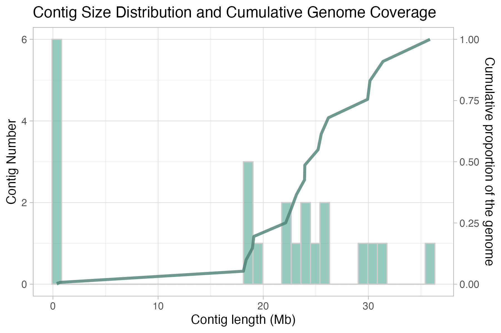
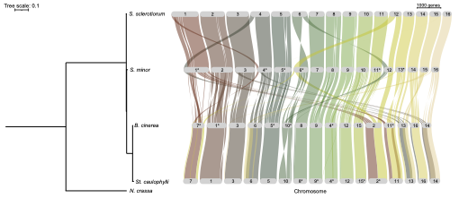
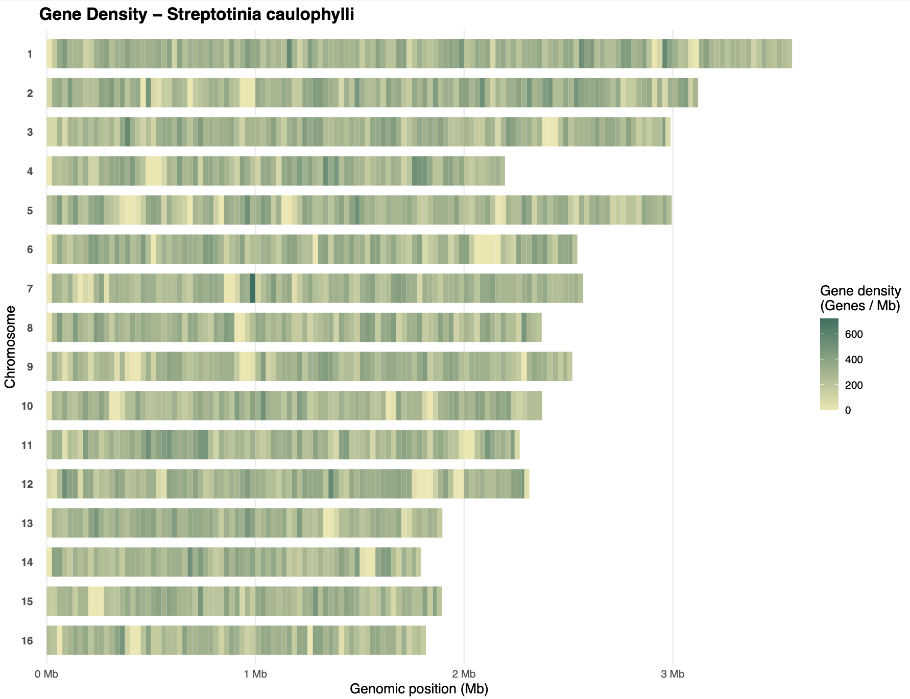
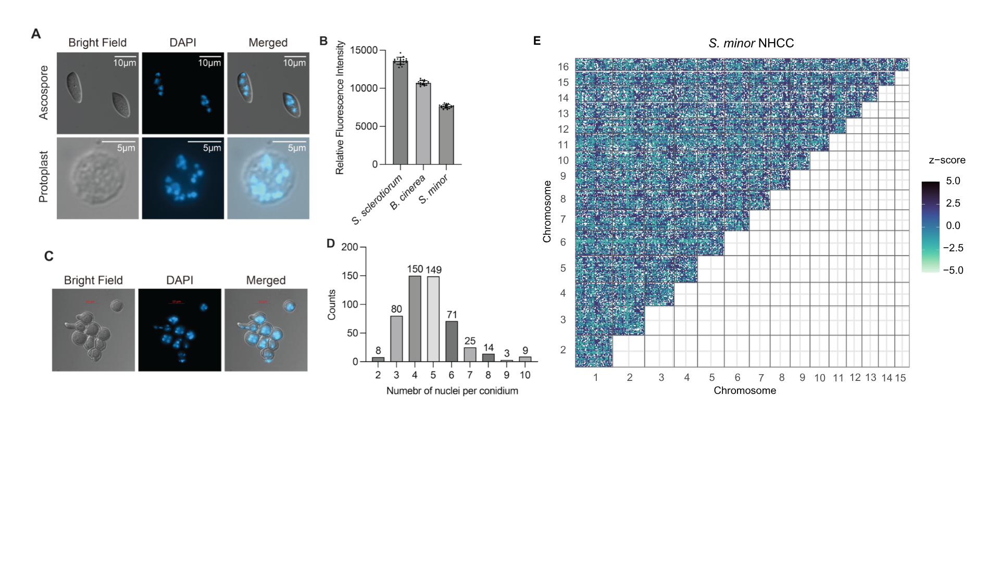

# Genomic analysis of *Sclerotinia minor* and *Streptotinia caulophylli*, and their virulence Sclerotiniaceae relatives

Methodology scripts pertaining to the chromosome-level genome assemblies and annotations of S. minor and St. caulophylli.

### Key contacts/authors:
Padgett, Esme (PhD Student, UBC) - esme.padgett@msl.ubc.ca

Todesco, Marco (PhD, Assistant Prof, **Princinple Investigator**, UBC) - mtodesco@msl.ubc.ca

## Repo contents
### Genome assembly

Genome assembly and manual curation using HiFi and HiC sequences of Streptotinia caulophylli

**Snippet of code contained in the *genome_asm* folder:**

- hifiasm assembly -> genome_asm.sh
- repeat annotation -> *renaming_asm.sh*
- telomere annotation -> *probe_repeat_scan.py*
- YaHS + Juicer HiC visualization -> *rename_juicer_contigs.sh*
- contig distribution plot -> *cumulative_contig_distribution_plot.R*

### Genome annotation

Analyses of genome annotation (gene and protein features), following complete genome assembly in *genome_asm* folder. Analyses are stored in folders **phylogeny, secretome, supp_materials**, but additional data is available in **annotation_data**.

**Snippet of code contained in the *genome_annotation* folder:**

	**phylogeny**

	- synteny analysis -> *genespace_initialize.sh/genespace_run.R/riparian_plot_visualization.R*
	- phylogenetic tree -> *riparian_visualization.R*

	**secretome**

	- effector annotation from Funannotate outputs -> *effector_annotation.sh*
	**supp_materials**

	- track gene density across genomes -> *gene_density.R*

### NHCC

Transformation of HiC sequencing data to detect non-homologous chromosome contacts (NHCC), to determine if there are biased interactions among non-normally sorting fungal chromosomes, using the **SIGNATURE** pipeline from DOI: 10.1038/s41467-024-53983-y

**Snippet of code contained in the *nhcc* folder:**

- HiC data preprocessing and normalization -> *signature_preprocessing.sh/custom_coolerdumpToSignature.py*
- running SIGNATURE pipeline -> *custom_batch_create_signature_files.sh*
- visualization -> *nhccheatmap_visualization.R*

END of README
