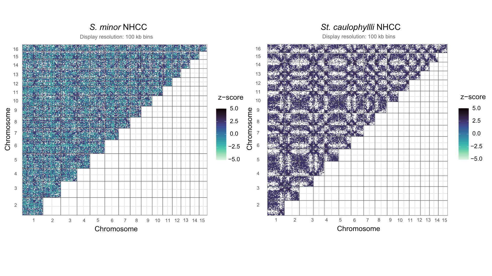

# NHCC (Non-Homologous Chromosome Contacts) Analysis

## Transformation of HiC sequencing data to detect non-homologous chromosomal contacts (NHCC) aka inter-chromosomal/trans-chromosomal contacts using a modified SIGNATURE pipeline (DOI: 10.1038/s41467-024-53983-y)

### Code contained in the *nhcc* folder:

**SIGNATURE**: lightly modified scripts from the SIGNATURE pipeline due to HPC operating systems and the species of interest diverging from the human genome used in SIGNATURE LWPR (16 chromosomes, no sex chromosomes)
- HiC data preprocessing and normalization -> *signature_preprocessing.sh/custom_coolerdumpToSignature.py*
- running SIGNATURE pipeline -> *custom_batch_create_signature_files.sh*
- visualization -> *nhccheatmap_visualization.R*

Referenced code

**signature_preprocessing.sh**: Normalize HiC contacts

**custom_coolerdumpToSignature.py**: Reformat between programs to run SIGNATURE, customized for HPC OS

**custom_batch_create_signature_files.sh**: Run SIGNATURE LWPR unsupervised learning method to detect significant NHCC from transformed HiC data, modified for HPC OS and 16 chromosomes (no gomosomes) in accordance to personal communications with Dr. Milad Mohkaridoost. For use, please see SIGNATURE GitHub: https://github.com/MaassLab/Signature

**nhccheatmap_visualization.R**: create heat map of NHCCs

END of README